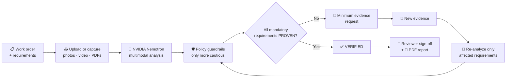
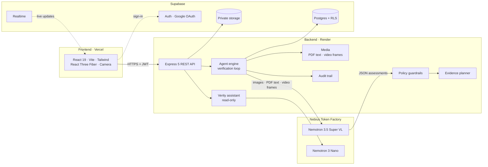

<div align="center">
EvidenceLoop
Prove the work. Don't just trust the photo.
Agentic, multimodal evidence verification for real-world work, powered by NVIDIA Nemotron on Nebius Token Factory.


🚀 Live Demo · 🎥 Demo Video · 🧭 2-Minute Demo Script
<br/>

</div>
---
Table of Contents
The Problem
The Solution
How It Works
Key Features
Screenshots
How NVIDIA Nemotron Is Used
Guardrails: Honest by Design
Roles
Architecture
Tech Stack
Try It
Quick Start
Project Structure
Testing & Quality
Security
Limitations
Roadmap
Hackathon Submission
License
Author
---
The Problem
Every day, field work like installations, repairs and safety checks is signed off with a single photo that nobody really checks.
📷 A photo of a light fitting doesn't show the right model, the wiring, or a working test.
🎲 Image classifiers say what is in a picture, not whether a job is done, and they guess when unsure.
🔁 When proof is missing, technicians get vague rework requests like "send more photos."
🗂️ There is no audit trail of why a job was accepted.
The Solution
EvidenceLoop is an AI agent that checks whether the evidence actually proves each requirement of a work order.
> A technician says *"Emergency light in Room 204 replaced."* EvidenceLoop checks every requirement (correct unit, correct location, securely mounted, wired, indicator working, functional test done) against the photos, video and documents. It marks each one **`PROVEN`**, **`NOT_PROVEN`**, **`UNCERTAIN`** or **`CONTRADICTED`**, explains why, and asks for **exactly** the missing proof:
>
> *"Upload a 5–10 second video showing the emergency light functional test."*
>
> The technician records it right in the app. EvidenceLoop re-checks **only the requirements it affects**, a reviewer signs off, and the whole decision chain is exported as a PDF.
Traditional sign-off	EvidenceLoop
"Looks fine" from a single photo	Each requirement judged on its own evidence
AI guesses when unsure	Insufficient evidence → `NOT_PROVEN`, stated plainly
Vague "send more photos"	Minimum, specific, merged evidence requests
Re-check everything every time	Re-analyze only the affected requirements
Same person does and approves the work	Separate technician and reviewer roles
No record of why	Requirement → Evidence → Observation → Reasoning → Decision, stored
---
How It Works

Plan: build a checklist from the work order, or draft it from an uploaded SOP.
Analyze: Nemotron looks at photos, PDF text and timestamped video frames together.
Guard: a code-enforced policy checks every model answer and can only downgrade, never upgrade.
Request: missing proof is merged into the fewest, most specific requests.
Re-analyze: new evidence re-checks only what it affects, from scratch.
Decide: `VERIFIED` only when every mandatory requirement is `PROVEN`.
Sign off: a separate reviewer approves, rejects or asks for more. Everything is audited.
---
Key Features
<table>
<tr>
<td width="50%" valign="top">
🤖 Agentic Verification Loop
Plan → analyze → guard → detect missing or contradicting evidence → request → re-analyze. Not a one-shot classifier.
🎯 Minimum Evidence Requests
Missing needs are merged by kind, so one functional-test video can settle several requirements.
🎞️ True Multimodal Input
Photos, PDF text layers, timestamped video frames and text. Video observations jump the player to the cited second.
📸 In-App Camera Capture
Take photos or record short videos directly from a phone or laptop camera. Photos are compressed before upload, and captures are tagged in the audit trail.
💬 Verity: AI Verification Co-pilot
Ask "Why isn't Room 204 verified?" or "What should I upload next?". Verity answers from your real work-order data, runs on Nemotron Nano, and is strictly read-only.
🌐 Live 3D Verification Graph
A React Three Fiber graph on every work order. Nodes change colour as decisions arrive, with quality adapted to real FPS and a 2D fallback.
</td>
<td width="50%" valign="top">
👥 Technician & Reviewer Consoles
Technicians do the work in their own workspace. Reviewers get a separate review queue and audit log. Roles come from the database and are enforced by the backend and Row Level Security.
🔐 Real Sign-in
Google sign-in plus email/password with validation and email confirmation. Public Privacy and Terms pages.
📑 Requirements from an SOP
Upload a manual and Nemotron proposes requirements, each with a verbatim quote. You review before anything is saved.
🧾 Full Audit Trail
Every run, decision, request, capture and sign-off on a timeline.
📄 PDF Report
Requirements, evidence with SHA-256 hashes, observations, decisions, audit trail and disclaimer in one file.
⚡ Fast & Durable
Everything is saved in Supabase. Cached data, code-split pages and a keep-alive ping keep the app responsive.
</td>
</tr>
</table>
---
Screenshots
<table>
<tr>
<td align="center" width="50%"><b>Dashboard</b><br/></td>
<td align="center" width="50%"><b>Work Order + 3D Verification Graph</b><br/></td>
</tr>
<tr>
<td align="center" width="50%"><b>Evidence Viewer</b><br/></td>
<td align="center" width="50%"><b>Landing: 3D Evidence Loop</b><br/></td>
</tr>
</table>
<sub>Screenshots show seeded demo data, labelled "Simulated · dev fixture". Run verification on the live site for real Nemotron results.</sub>
---
How NVIDIA Nemotron Is Used
NVIDIA Nemotron on Nebius Token Factory is the only AI in EvidenceLoop. There is no other model or AI SDK, and the browser never calls the model directly.
	
Verification model	`nvidia/Nemotron-3.5-Super-VL` (vision-language): judges evidence, drafts requirements from SOPs
Assistant model	`nvidia/NVIDIA-Nemotron-3-Nano-30B-A3B` (set by `NEBIUS_ASSISTANT_MODEL`): fast, low-cost chat for Verity
Provider	Nebius Token Factory, OpenAI-compatible `/chat/completions`
Mode	JSON output, temperature 0, retries with backoff on 429 / 5xx / timeouts
Where	`backend/src/ai/nebiusProvider.ts`, `backend/src/assistant/`, `backend/src/lib/nebius.ts`
Status	✅ Verified live: text + vision checks pass (`npm run check:nebius`)
Right model for each job: Super VL handles the heavy multimodal reasoning, and Nano answers chat questions quickly so the app stays responsive and credits last longer.
What the verifier receives: one multimodal message with the work order, every requirement and every piece of evidence, each tagged with an `evidenceId`.
Evidence	Sent as
📷 Photos (uploaded or captured)	Inline images
📄 PDFs	Extracted text layer
🎥 Video	Up to 8 frames, each labelled with its timestamp (`t=0:04`)
📝 Text	Inline
🔊 Audio · scanned PDFs	Declared as "attached but NOT inspected", so the model can't pretend
What it returns: one JSON assessment per requirement, with `status`, `observations` (each citing an `evidenceId`, marked `direct` or `inferred`, with video timestamps), `reasoning`, calibrated `confidence` (or `null`) and specific `missingEvidence` requests.
Where Nebius Token Factory accelerated the build
OpenAI-compatible API: integrated with plain `fetch` in one small client. No SDK to learn, no lock-in.
One model for vision + reasoning + JSON: no separate OCR, captioning or classifier service.
Right-sized models: switching between Super VL and Nano is one environment variable.
Playground iteration: prompts and the JSON schema were tried in the Token Factory Playground first.
Hosted inference: no GPUs to manage, so the backend runs on a small instance.
---
Guardrails: Honest by Design
The model proposes. `agent/policy.ts` decides, and it can only make a decision more cautious.
❌ `PROVEN` without a direct observation of an attached file → downgraded
❌ `CONTRADICTED` without cited evidence → downgraded to `UNCERTAIN`
❌ Observations citing files that aren't attached → dropped
❌ Missing or malformed answers → `NOT_PROVEN`
🗣️ Unproven requirements always state: "I cannot verify this requirement from the available evidence."
🔒 Confidence is passed through or dropped, never invented
✅ `VERIFIED` only when every mandatory requirement is `PROVEN`
💬 Verity is read-only: it explains results but can never change them, and it says so when data is missing
> EvidenceLoop **assists** verification. It does not replace qualified inspectors or certification, and it never claims physical safety is guaranteed.
---
Roles
	Technician	Reviewer (admin)
Create work orders	✅	—
Upload / capture evidence, run verification	✅ own work orders	❌
Submit for review	✅	—
Review queue: approve / reject / request evidence	❌	✅ (note required)
Audit log across all work orders	❌	✅
Ask Verity	✅ own data	✅ review queue
Every new account is a technician. Roles live in `public.user_roles` and can't be changed from the app. To make an account a reviewer, run in the Supabase SQL editor:
```sql
insert into public.user_roles (id, role) select id, 'reviewer' from auth.users where email = 'reviewer@example.com' on conflict (id) do update set role = excluded.role;
```
---
Architecture

---
Tech Stack
Layer	Technology
AI	NVIDIA Nemotron 3.5 Super VL + Nemotron 3 Nano via Nebius Token Factory
Frontend	React 19, Vite 8, TypeScript, Tailwind CSS 4, React Router, Framer Motion
3D	Three.js, React Three Fiber, Drei, Postprocessing
Backend	Node.js 20, Express 5, TypeScript
Media	`unpdf` (PDF text), `ffmpeg-static` (video frames), MediaRecorder / getUserMedia (capture)
Data & Auth	Supabase Postgres with Row Level Security, Auth (Google + email), private Storage, Realtime
Deploy	Vercel (frontend), Render (backend)
---
Try It
Live: https://evidenceloop-phi.vercel.app
Sign in with Google, or sign up with email and confirm the link in your inbox.
Create a work order from the Emergency light replacement template (or open a demo work order).
Upload or capture photos, then click Run verification.
See which requirements are proven, and the specific evidence request.
Record the requested video in the app, and watch only the affected requirements re-check.
Ask Verity: "Why is this work order verified?"
Submit for review and export the PDF report.
> The backend runs on Render's free tier. If it has been idle, the first request can take up to a minute while it wakes up.
---
Quick Start
> Requires **Node.js 20.12+**
```bash
# 1. Clone
git clone https://github.com/mokshadpoojary9-bot/evidenceloop.git && cd evidenceloop

# 2. Install
npm install

# 3. Configure (add your Nebius key + model, or set DEV_FIXTURE_AI=true)
cp backend/.env.example backend/.env

# 4. Load demo data
npm run seed:demo

# 5. Run API (:4000) + app (http://localhost:5173) together
npm run dev
```
With no Supabase values, the app runs in local mode (no sign-in, data in `backend/.data/`).
<details>
<summary><b>Environment variables</b></summary>
<br/>
Backend (`backend/.env`, never committed)
Variable	Required	Description
`NEBIUS_API_KEY`	✅	Nebius Token Factory API key (secret)
`NEBIUS_BASE_URL`	✅	`https://api.tokenfactory.nebius.com/v1`
`NEBIUS_MODEL`	✅	`nvidia/Nemotron-3.5-Super-VL`
`NEBIUS_ASSISTANT_MODEL`	optional	Verity's chat model (default `nvidia/NVIDIA-Nemotron-3-Nano-30B-A3B`)
`SUPABASE_URL`	optional	Supabase project URL
`SUPABASE_SECRET_KEY`	optional	Supabase secret key (secret, backend only)
`SUPABASE_STORAGE_BUCKET`	optional	`evidence`
`CORS_ORIGIN`	✅	Allowed frontend origins, comma-separated
`MAX_UPLOAD_MB`	optional	Upload size limit (default `50`)
`DEV_FIXTURE_AI`	optional	`true` = labelled simulated AI for local dev only (disabled in production)
Frontend (`frontend/.env.local`, public values only)
Variable	Description
`VITE_API_BASE_URL`	Backend URL (blank locally)
`VITE_SUPABASE_URL`	Supabase project URL
`VITE_SUPABASE_PUBLISHABLE_KEY`	Supabase publishable key
</details>
<details>
<summary><b>Supabase + Google sign-in</b></summary>
<br/>
Create a Supabase project and run `supabase/schema.sql` in the SQL editor.
Fill in the Supabase values in `backend/.env` and `frontend/.env.local`, then run `npm run check:supabase`.
Google: in Google Cloud, create an OAuth client (Web application).
Authorized JavaScript origins: your site URL(s), e.g. `http://localhost:5173`
Authorized redirect URI: `https://<project>.supabase.co/auth/v1/callback`
In Supabase → Authentication → Sign In / Providers → Google: enable it and paste the Client ID and Secret.
In Supabase → Authentication → URL Configuration: set the Site URL and add `<your site>/**` to Redirect URLs.
Sign up in the app, then seed your account: `npm run seed:demo -- --owner <your email>`.
</details>
<details>
<summary><b>Deploy (Render + Vercel)</b></summary>
<br/>
Render: New → Blueprint → this repo (uses `render.yaml`). Set the backend variables above with `NODE_ENV=production` and `DEV_FIXTURE_AI=false`.
Vercel: import the repo, Root Directory `frontend`, preset Vite, and set the three `VITE_*` variables (`VITE_API_BASE_URL` = your Render URL).
Render: set `CORS_ORIGIN` to your Vercel URL (plus localhost for development).
Supabase: set the Site URL and Redirect URLs to your Vercel URL.
Check: `npm run smoke -- <render-url> <vercel-url>`.
Optional keep-alive: ping `<render-url>/health/ping` every 10 minutes (e.g. cron-job.org) so the free tier doesn't sleep.
</details>
<details>
<summary><b>Useful scripts</b></summary>
<br/>
Command	What it does
`npm run dev`	API + app with hot reload
`npm run check`	Lint → typecheck → tests → build
`npm run check:nebius`	Live text + vision test against Nemotron
`npm run check:supabase`	Verifies tables, RLS and storage bucket
`npm run check:media`	Verifies PDF and video processing
`npm run seed:demo`	Loads demo work orders (`-- --reset` removes them)
`npm run smoke -- <api> <web>`	Production smoke test
</details>
---
Project Structure
```
evidenceloop/
├── backend/src/
│   ├── agent/        # engine (loop) · policy · planner · sopDraft · audit
│   ├── ai/           # nebiusProvider · devFixtureProvider · liveCheck
│   ├── assistant/    # Verity: context · knowledge · rateLimit
│   ├── media/        # PDF text · video frames
│   ├── reports/      # PDF export
│   ├── routes/       # work orders · requirements · reviews · assistant · health
│   ├── stores/       # Supabase + local stores
│   └── scripts/      # check:nebius · check:supabase · seed:demo · smoke
├── frontend/src/
│   ├── components/ui/   # design system
│   └── components/      # Dashboard · WorkOrderDetail · ReviewQueue · AuditLog
│                        # CameraCapture · VerityPanel · 3D scenes · Login · Legal
├── demo/             # sample evidence (see demo/SOURCES.md)
├── supabase/         # schema.sql (tables, RLS, Realtime, storage)
├── docs/screenshots/ # README images
├── render.yaml       # backend deploy
├── DEMO.md           # 2-minute demo script
└── LICENSE           # MIT
```
---
Testing & Quality
✅ 230+ automated tests across backend (policy, planner, engine, routes, media, assistant) and frontend (components, roles, camera, Verity, landing, 3D fallback)
✅ `npm run check` runs lint → typecheck → tests → build
✅ Full verification loop tested end-to-end over HTTP
✅ Responsive down to 375px, light and dark mode, keyboard accessible
✅ 3D scenes adapt to real FPS, respect `prefers-reduced-motion`, and fall back to 2D
---
Security
🔐 `NEBIUS_API_KEY` and `SUPABASE_SECRET_KEY` live only on the backend and are never logged
🔐 The browser only holds the Supabase publishable key
🔐 Row Level Security on every table; roles enforced in the backend and the database
🔐 Private storage bucket served through short-lived signed URLs
🔐 Uploads size-limited, type-checked and SHA-256 hashed
🔐 Google OAuth + confirmed email sign-in; safe same-site redirects only
🔐 Verity is read-only and rate-limited per user
---
Limitations
🔊 Audio and scanned PDFs without a text layer are not inspected yet (clearly labelled)
🎥 Video is analysed as up to 8 still frames
🖼️ The bundled demo images are illustrations; use real photos for real-model results
💤 The free Render tier can take up to a minute to wake after being idle
⚖️ EvidenceLoop assists human inspectors and does not replace certification
Roadmap
[ ] Audio transcription for spoken test confirmations
[ ] OCR for scanned PDFs
[ ] Offline mobile capture with guided evidence shots
[ ] Multi-organisation workspaces and custom requirement libraries
[ ] Webhooks for CMMS / ticketing integrations
---
Hackathon Submission
	
Hackathon	Nebius × NVIDIA Global AI Hackathon
Track	Best Apps and Agents
NVIDIA models	`nvidia/Nemotron-3.5-Super-VL` · `nvidia/NVIDIA-Nemotron-3-Nano-30B-A3B`
Runs on	Nebius Token Factory (runtime inference API)
Live demo	https://evidenceloop-phi.vercel.app
Built	During the submission period (Aug 26 – Oct 30, 2026)
License
Released under the MIT License.
---
Author
<div align="center">
Moksha Poojary

Built for the Nebius × NVIDIA Global AI Hackathon · Powered by NVIDIA Nemotron on Nebius Token Factory
<br/>
⭐ If you like EvidenceLoop, give it a star! ⭐
</div>
