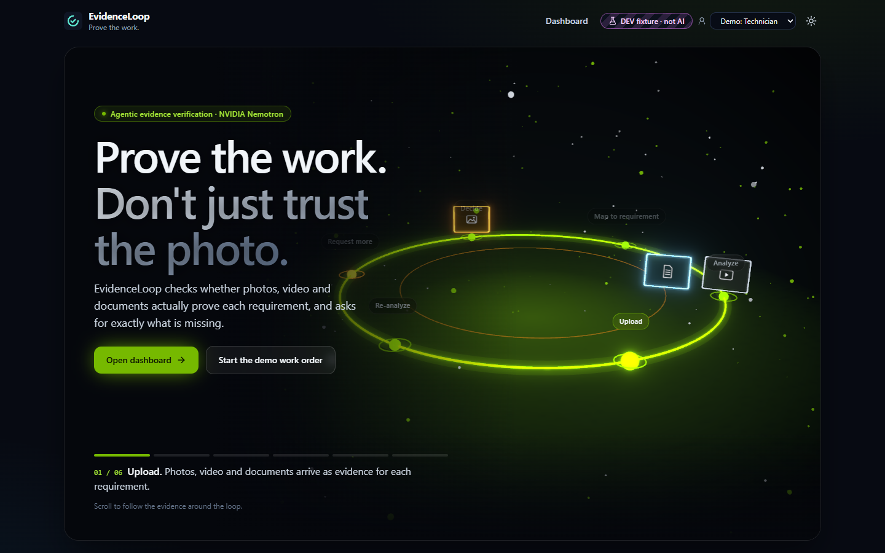
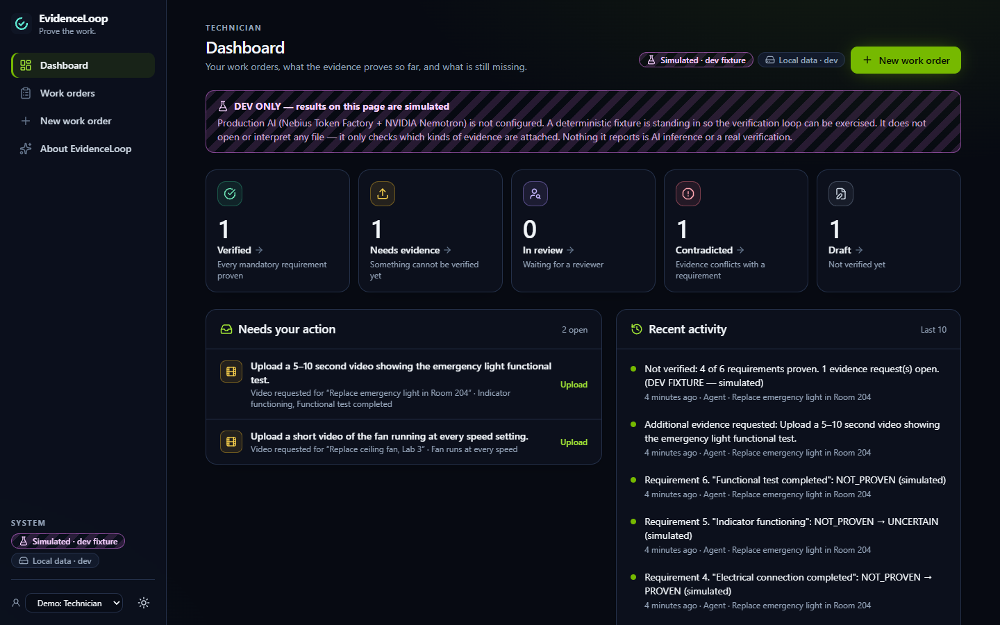
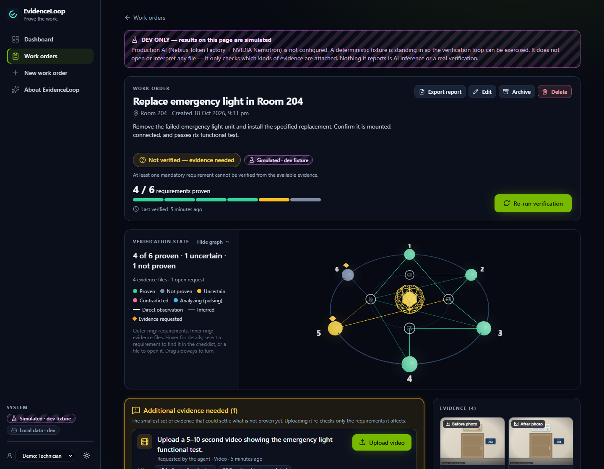
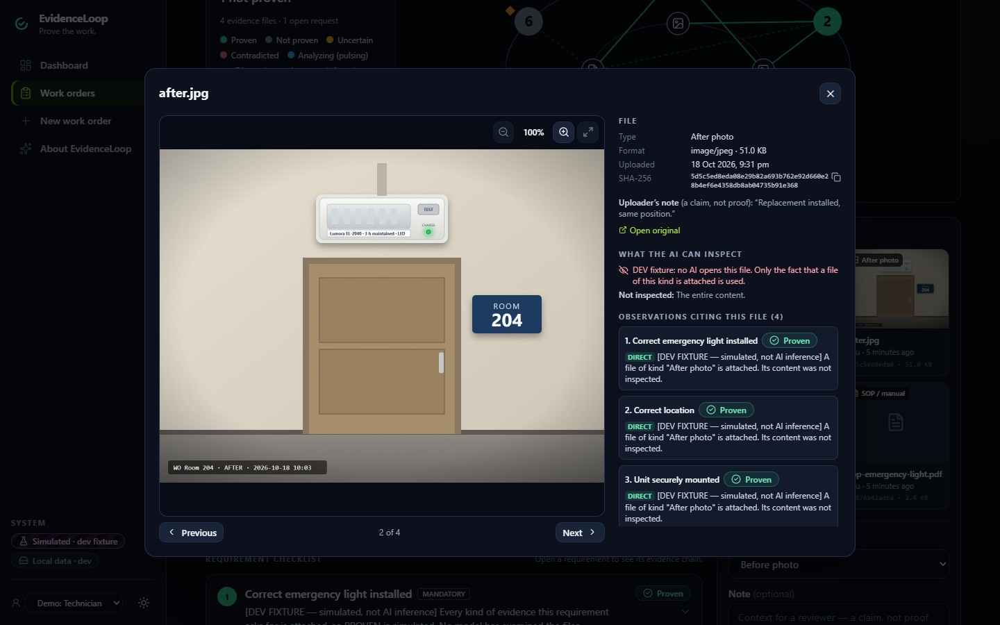

<div align="center">

🔍 EvidenceLoop
Prove the work. Don't just trust the photo.
An AI agent that verifies whether photos, videos and documents actually prove real-world work was completed.
<br/>


<br/>
🚀 Live Demo  •  🎥 Demo Video  •  📖 Demo Guide
<sub>Built for the Nebius × NVIDIA Global AI Hackathon · Track: Best Apps and Agents</sub>
</div>
<br/>
📖 What is EvidenceLoop?
EvidenceLoop is an AI-powered verification platform for real-world work such as repairs, installations and safety checks.
When a technician says a job is done, EvidenceLoop checks whether the photos, videos and documents actually prove it. It does not simply look at a picture and say "looks fine". It checks every requirement of the job one by one, explains its decision, and when proof is missing, it asks for exactly the evidence that is needed.
It is powered by NVIDIA Nemotron models running on Nebius Token Factory, and it includes separate workspaces for the technician who does the work and the reviewer who approves it.
> **In one line:** EvidenceLoop turns "trust me, it's done" into "here's the proof."
<br/>
🌐 Live Demo
	Link
🚀 Web app	https://evidenceloop-phi.vercel.app
⚙️ Backend API (health check)	https://evidenceloop.onrender.com/health
🎥 Demo video	(YouTube link)
📖 Demo guide	DEMO.md
How to use it in the browser:
Open the web app in Chrome, Edge or Firefox (desktop or mobile).
Click Open dashboard → Continue with Google.
Create a work order, upload evidence, and click Run verification.
<sub>The backend runs on a free server — if it was idle, the first load can take up to a minute.</sub>
<br/>
📑 Table of Contents
		
📖 What is EvidenceLoop?	🌐 Live Demo	💡 Overview
⚙️ How It Works	✨ Features	🧠 NVIDIA Nemotron
🛡️ Guardrails	👥 User Roles	🏗️ Tech Stack
📸 Screenshots	🚀 Getting Started	🧪 Try It
🔒 Security	🗺️ Roadmap	
<br/>
💡 Overview
The Problem
Maintenance and safety jobs are approved from a single photo that nobody really checks.
> 📷 A photo doesn't prove the right part, the wiring, or a working test.
> 🎲 Image classifiers say *what's in a picture* — not *whether the job is done*.
> 🔁 Rework requests are vague: *"send more photos."*
> 🗂️ There's no record of **why** a job was accepted.
The Solution
EvidenceLoop judges every requirement against the evidence — and asks for exactly what's missing.
Traditional sign-off	✅ EvidenceLoop
"Looks fine" from one photo	Every requirement judged on its own evidence
AI guesses when unsure	Says "I cannot verify this" when proof is weak
"Send more photos"	"Upload a 5–10 second video of the functional test"
Re-check everything	Re-checks only what the new evidence affects
Same person does and approves	Separate technician and reviewer
No record of why	Full audit trail + PDF report
<br/>
⚙️ How It Works
Example job: Replace the emergency light in Room 204 — 6 requirements: correct unit · correct location · securely mounted · electrical connection · indicator working · functional test.
Step		What happens
1	📋 Plan	Checklist created from a template — or drafted by Nemotron from an SOP manual
2	📤 Collect	Technician uploads or captures photos, documents and video
3	🧠 Analyze	Nemotron reads all evidence together and judges each requirement
4	🛡️ Guard	Our policy code checks every AI answer — it can only become more cautious
5	📝 Request	Missing proof becomes one specific, actionable request
6	🔁 Re-check	New evidence re-analyzes only the affected requirements
7	✅ Approve	Verified → a separate reviewer signs off → PDF report
Each requirement ends as 🟢 Proven · ⚪ Not proven · 🟡 Uncertain · 🔴 Contradicted
<br/>
✨ Features
	Feature	Description
🤖	Agentic verification loop	Plans, checks, requests evidence and re-checks automatically
🎞️	Multimodal evidence	Photos, PDF documents and videos with timestamped frames
📸	In-app camera	Take photos or record videos directly from phone or laptop
💬	Verity assistant	Ask "Why isn't this verified?" — answers from real data, read-only
👥	Technician & Reviewer consoles	Separate workspaces; you can't approve your own work
📑	SOP → requirements	Nemotron drafts the checklist with exact quotes from the manual
🌐	Live 3D verification graph	Requirements change colour as decisions arrive
🔐	Google sign-in	Plus verified email and password
🧾	Audit trail & PDF report	Every action recorded and exportable
<br/>
🧠 NVIDIA Nemotron
Every AI decision in EvidenceLoop runs on NVIDIA Nemotron via Nebius Token Factory.
Model	Role	Why this model
Nemotron 3.5 Super VL<br/><sub>`nvidia/Nemotron-3.5-Super-VL`</sub>	🔍 Evidence verification<br/>📑 SOP → requirements	Vision + strong reasoning + reliable structured output
Nemotron 3 Nano<br/><sub>`nvidia/NVIDIA-Nemotron-3-Nano-30B-A3B`</sub>	💬 Verity assistant	Fast and low-cost for instant answers
📥 Input (one call): work order · all requirements · photos · PDF text · up to 8 timestamped video frames
📤 Output (per requirement): status · cited observations · reasoning · confidence · exact missing evidence
⚡ Where Nebius Token Factory helped
OpenAI-compatible API — integrated in minutes with plain `fetch`, no SDK
One vision model — replaced separate OCR and image-captioning tools
Right-sized models — switching Super VL ↔ Nano is one setting
Hosted inference — no GPUs to manage; the backend stays lightweight
<br/>
🛡️ Guardrails
> **The model proposes. Our code decides.**
Rule	Effect
No direct observation of a real file	❌ Cannot be Proven
Cites a file that doesn't exist	❌ Citation removed
Missing or invalid AI answer	❌ Becomes Not proven
Insufficient evidence	🗣️ "I cannot verify this requirement from the available evidence."
Any mandatory requirement unproven	❌ Job cannot be Verified
Verity assistant	🔒 Read-only — explains, never changes results
<sub>EvidenceLoop supports inspectors. It does not replace official certification or guarantee physical safety.</sub>
<br/>
👥 User Roles
Capability	🔧 Technician	🛡️ Reviewer
Create work orders	✅	—
Upload / capture evidence	✅	—
Run AI verification	✅	—
Submit for review	✅	—
Approve · reject · request evidence	—	✅
Audit log of all work orders	—	✅
<br/>
🏗️ Tech Stack
Layer	Technologies
🧠 AI	NVIDIA Nemotron 3.5 Super VL, Nemotron 3 Nano · Nebius Token Factory
🎨 Frontend	React 19 · Vite · TypeScript · Tailwind CSS · React Three Fiber · Framer Motion
⚙️ Backend	Node.js · Express · TypeScript
🎞️ Media	PDF text extraction · ffmpeg video frame sampling · in-browser camera
🗄️ Data & Auth	Supabase — Postgres with Row Level Security · Storage · Realtime · Google OAuth
☁️ Hosting	Vercel (frontend) · Render (backend)
<br/>
📸 Screenshots
<table>
  <tr>
    <td align="center"><b>Dashboard</b><br/></td>
    <td align="center"><b>Work Order + 3D Graph</b><br/></td>
  </tr>
  <tr>
    <td align="center"><b>Evidence Viewer</b><br/></td>
    <td align="center"><b>Landing Page</b><br/></td>
  </tr>
</table>
<br/>
🚀 Getting Started
Prerequisite: Node.js 20.12+
```bash
git clone https://github.com/mokshadpoojary9-bot/evidenceloop.git
cd evidenceloop
npm install
cp backend/.env.example backend/.env
npm run seed:demo
npm run dev
```
Open http://localhost:5173
<details>
<summary><b>⚙️ Environment variables</b></summary>
<br/>
Backend — `backend/.env`
Variable	Description
`NEBIUS_API_KEY`	Nebius Token Factory API key (secret)
`NEBIUS_BASE_URL`	`https://api.tokenfactory.nebius.com/v1`
`NEBIUS_MODEL`	`nvidia/Nemotron-3.5-Super-VL`
`NEBIUS_ASSISTANT_MODEL`	`nvidia/NVIDIA-Nemotron-3-Nano-30B-A3B`
`SUPABASE_URL` · `SUPABASE_SECRET_KEY`	Database connection (optional locally)
`CORS_ORIGIN`	Allowed frontend URL(s)
Frontend — `frontend/.env.local`
Variable	Description
`VITE_API_BASE_URL`	Backend URL (empty locally)
`VITE_SUPABASE_URL`	Supabase project URL
`VITE_SUPABASE_PUBLISHABLE_KEY`	Supabase public key
</details>
<br/>
🧪 Try It
Step	Action
1	Open evidenceloop-phi.vercel.app (first load may take ~1 min)
2	Sign in with Google
3	New work order → Emergency light replacement → Create
4	Upload sample files from `demo/room-204/` → Run verification
5	Upload `functional-test.mp4` when requested
6	Ask Verity: "Why is this work order verified?"
7	Submit for review → Export report
<br/>
🔒 Security
🔑 API keys live only on the server — never in the browser
🛡️ Row Level Security on every table · roles enforced server-side
📁 Private storage with short-lived signed URLs
#️⃣ Every upload SHA-256 fingerprinted
<br/>
🗺️ Roadmap
[ ] 🎙️ Audio transcription for spoken test confirmations
[ ] 📄 OCR for scanned documents
[ ] 📱 Guided mobile photo capture
[ ] 🏢 Team workspaces
[ ] 🔗 Maintenance ticketing integrations
<br/>
---
<div align="center">
👨‍💻 Built by Moksha Poojary

Nebius × NVIDIA Global AI Hackathon · Powered by NVIDIA Nemotron on Nebius Token Factory
Licensed under the MIT License
⭐ If you find EvidenceLoop useful, give it a star!
</div>
