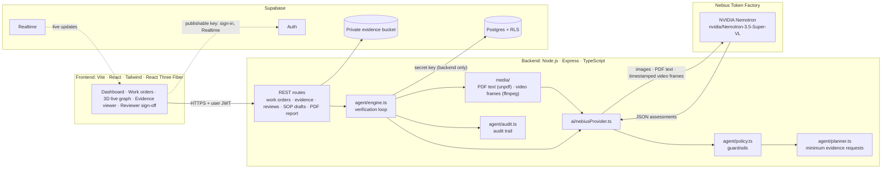

# EvidenceLoop

**Prove the work. Don't just trust the photo.**

Built for the **Nebius × NVIDIA Global AI Hackathon** · AI: **NVIDIA Nemotron via Nebius Token Factory**

- **Live demo:** <coming soon>
- **Demo video:** <coming soon>

## In 30 seconds

A technician says the job is done and uploads a photo. Does that photo actually prove that the
right unit was installed, mounted, connected and tested? EvidenceLoop is an **agent** that answers
that question for each requirement of a work order. NVIDIA Nemotron
(`nvidia/Nemotron-3.5-Super-VL`) looks at the photos, video frames and documents. A code-enforced
policy keeps it honest. Every requirement ends up `PROVEN`, `NOT_PROVEN`, `UNCERTAIN` or
`CONTRADICTED`, with the observations and reasoning behind it. When proof is missing, the agent
asks for the **minimum, specific** extra evidence ("Upload a 5–10 second video showing the
emergency light functional test."). When that evidence arrives, it re-checks **only the
requirements it affects**. A reviewer signs off, and the whole chain is exported as a PDF.

> EvidenceLoop assists verification. It does not replace qualified inspectors or certification,
> and it does not guarantee physical safety.

## Problem → solution

| Problem | EvidenceLoop |
| --- | --- |
| Field work is "proven" by a photo that nobody really checks. A photo of a light fitting doesn't show the right model, the wiring, or a working test. | Each requirement is judged on its own: does *this* evidence prove *this* requirement? A model-generated "looks fine" is not enough. A `PROVEN` status needs a direct observation of an attached file. |
| Image classifiers say what is in a picture, not whether a job is done, and they guess when they're unsure. | Nemotron reasons over the work order, the requirements and every piece of evidence together. Insufficient evidence is `NOT_PROVEN`, stated as "I cannot verify this requirement from the available evidence." |
| When proof is missing, people get vague rework requests ("send more photos"). | The agent's planner merges what is missing into the fewest, most specific requests. One upload can settle several requirements. |
| Re-checking everything after every upload is slow and noisy, and old AI conclusions get trusted blindly. | New evidence re-analyzes only the affected requirements, from scratch. Earlier conclusions are never fed back to the model. |
| There's no audit trail of *why* a job was accepted. | Requirement → Evidence → Observation → Reasoning → Decision is stored for every decision, alongside a timeline of every run, request and sign-off and a PDF report. |

## Architecture



**The loop:** plan the checklist → analyze evidence with Nemotron → policy checks every answer →
detect missing or contradicting evidence → request the minimum additional evidence → new upload →
re-analyze only the affected requirements → `VERIFIED` only when every mandatory requirement is
proven → reviewer sign-off.

## How NVIDIA Nemotron + Nebius Token Factory are used

Production AI is **NVIDIA Nemotron served by Nebius Token Factory**. It is the only inference
provider in this project. There is no other AI API or SDK, and the browser never calls the model.

- **Model:** `nvidia/Nemotron-3.5-Super-VL` (vision-language), set by `NEBIUS_MODEL`.
- **Endpoint:** Nebius's OpenAI-compatible `POST {NEBIUS_BASE_URL}/chat/completions`, called with
  plain `fetch` (`backend/src/lib/nebius.ts`, `chatCompletion`). It uses JSON mode and
  temperature 0, with retries and backoff on 429/5xx/timeouts. The key is read only by the
  backend and is never logged.
- **Verified live** on 2026-10-17: `npm run check:nebius` passed for text and image, and real
  verification runs and SOP drafts went through the adapter and the policy. On deliberately
  useless evidence (a blank photo, a test-pattern video, an unverified install sheet), Nemotron
  returned `NOT_PROVEN` for every requirement with the required "cannot verify" sentence. Each
  backend still proves its own connection with a startup live test. The UI says **"Nemotron
  connected"** only after that test passes, and "not configured / not verified" otherwise.

**What is sent** (`backend/src/ai/nebiusProvider.ts`, `NebiusNemotronProvider.assess`): one
multimodal message. It holds the work order, every requirement being checked, and every piece of
evidence, each tagged with its `evidenceId`:

| Evidence | How it is sent | Not inspected (declared to the model) |
| --- | --- | --- |
| Photos | Inline base64 image (≤ 5 MB) | Larger images |
| PDF | Text layer extracted on the backend (`unpdf`), first 20,000 characters | Scanned PDFs without a text layer, images inside PDFs |
| Video | Up to 8 still frames (about one every 2 s, spread wider for long clips), each labelled with its timestamp, e.g. `frame at t=0:04 (4 s)` (`ffmpeg-static`) | What happens between frames; the soundtrack |
| Text / transcript | Inline text, first 20,000 characters | The rest |
| Audio | — | Everything (no transcription) |

Anything not inspected is listed as "attached but NOT inspected", with the reason, so the model
cannot claim to have seen it. Uploader notes are marked as unverified claims.

**What comes back:** one JSON assessment per requirement, with `status`; `observations`, each
citing an `evidenceId`, marked `direct` or `inferred`, with `startSec`/`endSec` for video;
`reasoning`; a calibrated `confidence` (or `null`); and `missingEvidence` (specific, actionable
requests). The same adapter drafts requirements from an SOP (`draftRequirements`). Each proposal
must quote the SOP verbatim, and `agent/sopDraft.ts` discards any whose quote is not in the
document.

**How `agent/policy.ts` guards it** (`applyPolicy`, run on every model answer and covered by
`policy.test.ts`): the model proposes and the policy decides. The policy can only make a decision
*more* cautious:

- A missing, malformed or misaddressed answer becomes `NOT_PROVEN`.
- `PROVEN` without a direct observation of an actually attached file is downgraded to
  `UNCERTAIN` or `NOT_PROVEN`. `CONTRADICTED` with no cited evidence becomes `UNCERTAIN`.
- Observations that cite files not attached to the work order, and invalid timestamps, are
  dropped.
- Confidence is passed through or dropped, never computed. Out-of-range values are dropped, and
  so is the confidence of an overridden status.
- `NOT_PROVEN` and `UNCERTAIN` always say "I cannot verify this requirement from the available
  evidence."
- `VERIFIED` requires every mandatory requirement to be `PROVEN` (`overallStatus`). Any
  contradiction blocks it.

**The DEV fixture is clearly labelled.** `backend/src/ai/devFixtureProvider.ts` lets the loop run
without a key (`DEV_FIXTURE_AI=true`). It is **not AI inference**: it never opens a file and only
checks which *kinds* of evidence are attached. Everything it produces is stored with
`simulated: true` and shown as "Simulated · dev fixture" in the UI, the audit trail and the PDF
report, and it reports no confidence. It is ignored whenever Nebius is configured, and it can
never run with `NODE_ENV=production`.

## Key features

- **Agentic verification loop:** plan → analyze → policy → detect missing and contradicting
  evidence → request → re-analyze affected requirements only (`agent/engine.ts`).
- **Minimum evidence requests:** missing needs are merged by kind, so one functional-test video
  can settle two requirements. Requests can be answered inline on the work order page.
- **Multimodal evidence:** photos, PDFs (text layer), video (timestamped frames), text. Video
  observations jump the player to the cited moment.
- **3D live verification view:** a React Three Fiber graph of requirements and evidence on every
  work order. Nodes change colour as decisions arrive (Supabase Realtime), with a 2D fallback
  chosen by measured frame rate.
- **Requirements from an SOP:** Nemotron proposes requirements with verbatim quotes, and you
  review them before anything is saved.
- **Reviewer sign-off:** submit → in review → approve, reject or request evidence, enforced in the
  backend, by RLS and by a database trigger. Approval is a human decision, never shown as
  `VERIFIED`.
- **Audit trail:** every run, decision, request and sign-off on a timeline, grouped by run.
- **PDF report:** requirements, evidence with SHA-256, observations, decisions, requests, audit
  trail and the disclaimer.
- **Evidence viewer:** zoom and pan, video timeline markers, PDF pages, and what the AI can and
  cannot inspect for each file.

## Screenshots

| Landing (3D hero) | Dashboard |
| --- | --- |
|  |  |
| **Work order with the 3D verification graph** | **Evidence viewer** |
|  |  |

*The screenshots show the seeded demo data (`npm run seed:demo`) in local DEV mode, so every
result is labelled "Simulated · dev fixture". For the demo with real Nemotron, see
[DEMO.md](DEMO.md).*

## Run locally in 5 commands

Requires **Node.js 20.12+**.

```bash
git clone https://github.com/mokshadpoojary9-bot/evidenceloop.git && cd evidenceloop
npm install
cp backend/.env.example backend/.env   # set NEBIUS_API_KEY + NEBIUS_MODEL, or DEV_FIXTURE_AI=true
npm run seed:demo                      # three demo work orders (labelled simulated)
npm run dev                            # API on :4000, dashboard on http://localhost:5173
```

With no Supabase values, this runs in **local mode**: no sign-in, with data in `backend/.data/`.
Open a demo work order and follow the 2-minute click path in [DEMO.md](DEMO.md).

**With Supabase:** run `supabase/schema.sql`, fill in the Supabase values (see
[Connecting Supabase](#connecting-supabase)), sign up in the app and confirm your email, then seed
the demo into your account:

```bash
npm run seed:demo -- --owner <your email>
```

## Honest limitations

- **Audio is not inspected** (no transcription), and neither are video soundtracks. **Scanned
  PDFs without a text layer are not OCR'd.** Both are shown as "attached but not inspected", and
  the model is told so. Only NVIDIA Nemotron via Nebius may be used, so both wait for a Nemotron
  model on Token Factory that accepts audio or page images.
- Video is seen as at most 8 still frames. Nothing between frames is inspected.
- **The demo images are drawn illustrations**, made for the DEV fixture walkthrough. Real Nemotron
  judges them on what they actually show and may, correctly, refuse to verify them. For a
  real-model demo, use real photos and video.
- The seeded demo results come from the DEV fixture and are labelled simulated. Click **Run
  verification** with Nebius configured to get a real Nemotron result.
- EvidenceLoop **assists** verification. It does not replace qualified inspectors or
  certification, and it never claims physical safety is guaranteed.

---

## Supabase: current status

**Supabase has been verified live** (2026-10-18): auth, database, storage and Realtime.

- `npm run check:supabase` passes every check: the secret key, email sign-up with required email
  confirmation, all 9 tables with every column the backend uses, RLS enabled and read policies
  on every table, the Realtime publication, the review trigger, and a private `evidence` bucket.
- An end-to-end run against the live project, with real Nemotron, passed:
  - Sign-up returns no session until the email is confirmed, and sign-in is refused until then.
    Sign-out revokes the session.
  - Photos and the SOP PDF landed in the private bucket and were served only through signed URLs.
    Public URLs and the browser key are refused.
  - A Nemotron run gave every requirement a status and opened evidence requests. Realtime
    delivered the changes while the run was in flight, and nothing reached another technician.
  - A video answering the request triggered re-analysis, and the PDF report exported.
  - RLS was checked with three accounts, and the reviewer rules held in both the backend and the
    database.

  That run re-analyzed all six requirements, because none was proven yet. Re-analysis now covers
  only the affected ones (see *Re-analysis* below). That change is covered by tests but has not
  been re-run against Nemotron.

## The demo scenario

Work order: **Replace emergency light in Room 204.** Six requirements: correct unit installed,
correct location, securely mounted, electrical connection completed, indicator functioning,
functional test completed.

With the DEV fixture enabled:

1. Create the work order from the *Emergency light replacement* template.
2. Upload a before photo, an after photo, the SOP/manual and a close-up photo.
3. **Run verification** → four requirements proven, "Indicator functioning" uncertain,
   "Functional test completed" not proven.
4. The agent opens one request covering both: *"Upload a 5–10 second video showing the emergency
   light functional test."*
5. Upload a video against that request → only the affected requirements are re-analyzed → verified.

Adding `#contradict` to an upload's note makes the fixture simulate a contradiction (DEV ONLY).

### Seeded demo data

`npm run seed:demo` creates three work orders from the sample evidence in [`demo/`](demo/SOURCES.md):
Room 204 (4 of 6 proven, functional-test video requested), Corridor B (VERIFIED, with a full
request → answer → re-analysis loop) and Lab 3 (CONTRADICTED: wrong fan model). It uses the same
writes and verification engine as the API with the DEV fixture, so every result is labelled
simulated. No Nebius call is made. It is safe to run twice. `npm run seed:demo -- --reset` removes
only those three. In Supabase mode, pass the owning technician: `-- --owner you@example.com` (or set
`DEMO_OWNER_EMAIL`). In local mode, stop the API first. The 2-minute click path is in [DEMO.md](DEMO.md).

## Roles and reviewer sign-off

| Role | Can |
| --- | --- |
| **Technician** (default) | Create work orders, upload evidence, run verification, add requirements, edit/archive/delete their own work orders, submit for review |
| **Reviewer** | Read every work order, export reports, decide pending reviews. Cannot change work orders or upload evidence |

Each role has its own workspace, and the role comes only from `public.user_roles`:

- **Technician:** *Dashboard* (open evidence requests, drafts, and contradicted or uncertain
  work orders with a **Submit for review** button), *My work orders*, *New work order*.
- **Reviewer (admin):** marked with a violet **Reviewer** badge. *Review queue* (`/review`) lists
  in-review, contradicted and uncertain work orders from every technician, with the technician's
  name, submission time and score, and approve / reject / request more evidence (note required)
  once submitted. *All work orders*, and *Audit log* (`/audit`), the latest events across every
  work order, filterable by work order, event type, person and text.
- After sign-in, technicians land on the dashboard and reviewers on the review queue.

A work order that is **CONTRADICTED**, or **not verified with an UNCERTAIN requirement**, can be
submitted for review. It moves to **In review** and is frozen (no uploads, runs or checklist
changes). The reviewer then, always with a note:

- **approves** → *Approved by reviewer*. This is a human decision and is labelled as one; the
  unproven requirements stay unproven and the work order is never shown as *Verified*;
- **rejects** → *Rejected by reviewer*;
- **requests more evidence** → an evidence request from the reviewer, back to the technician.
  Re-analysis never retires a reviewer's request; only an upload answers it.

Every step is in the audit trail with the actor's role. Enforcement is in three places:

1. **Backend** — every route checks the role and ownership (`stores/workOrders.ts`,
   `routes/reviews.ts`); the UI only reflects the `permissions` the API returns.
2. **Row Level Security** — technicians read only their own work orders, reviewers read all;
   clients have no write path at all.
3. **Database trigger** on `public.reviews`, which also binds the backend's secret key: only a
   user with the reviewer role can decide a review, never the person who submitted it, and a
   decided review cannot be changed.

**Assigning roles (Supabase):** every user is a technician until an administrator makes them a
reviewer. The account must already exist (signed up and email confirmed). In the SQL editor:

```sql
insert into public.user_roles (id, role) select id, 'reviewer' from auth.users where email = 'you@example.com' on conflict (id) do update set role = excluded.role;
```

To make them a technician again: `delete from public.user_roles where id = (select id from auth.users where email = 'you@example.com');`
The new role applies on the user's next request; reload the dashboard. Reviewers do not create
work orders, so testing the flow needs two accounts: a technician who submits and a reviewer who
decides.

**Local mode:** a *Demo mode* Technician / Reviewer switcher acts as two fixed local users. It
appears only in local mode, and the backend honours it only when Supabase Auth is not configured.

## Requirements from an SOP

On the new-work-order form, or on an existing work order, upload an SOP or manual (PDF with a text
layer, or plain text) and click **Generate requirements**:

1. The backend extracts the text (`POST /api/requirements/draft`; nothing is stored) and asks
   Nemotron to propose requirements: title, description, mandatory yes/no, and the evidence that
   would prove each one.
2. Every proposal must quote the SOP passage it comes from. `agent/sopDraft.ts` drops any
   proposal whose quote is not in the document, so the model cannot invent requirements.
3. You review, edit and delete proposals in the browser. Only when you confirm are they saved
   (`POST /api/work-orders/:id/requirements`), with an audit event naming the source file.

With the DEV fixture the list is simulated — step-like lines copied verbatim from the SOP, with a
keyword guess at the evidence — and is labelled as such. Scanned PDFs without a text layer are
refused (422), and with no AI configured drafting is refused (503) rather than faked.

## Work order page

The main demo screen, top to bottom:

- **Header:** status, "4 / 6 requirements proven" with one bar segment per requirement, when it
  was last verified, Run verification and Export report. A provenance badge says
  "Verified by NVIDIA Nemotron via Nebius" only for a run that used Nemotron; fixture runs say
  "Simulated · dev fixture".
- **Evidence requests** (amber): each request, the requirements it affects (click to jump), and
  an upload button right there that answers that request.
- **Requirement cards:** mandatory/optional, status, the model-reported confidence or
  "Confidence not given", and the reasoning. Unproven cards say "I cannot verify this requirement
  from the available evidence." and list what is missing. Expanding shows the chain
  Requirement → Evidence → Observation (direct / inferred) → Reasoning → Decision; observations
  link to their evidence, and video timestamps open the player at that moment.
- **Evidence gallery:** thumbnails with kind, uploader, time and a short SHA-256; drag-and-drop
  upload with a progress bar and retry. The type and size are checked before uploading too.
- **Audit trail:** a timeline grouped by verification run, an icon per event, filter by type.

## Evidence viewer

Click any evidence file, or any evidence cited in a requirement's observations, to open it in the
viewer: images with zoom and pan (buttons, wheel, drag, or +/−/0 and arrow keys), video with the
citing observations marked on a timeline under the player (click a marker to jump), PDFs with
page navigation, audio, and text files. Audio and PDFs without a text layer carry a
**Not inspected** label: whether a PDF has a text layer is checked at upload and recorded in the
upload's audit event. Beside the preview are the file's metadata and full SHA-256, **what the AI
can actually inspect** for that file type, and every observation that cites the file.

## Sign-in redirect

A signed-out user is sent to `/login?next=<the full address, query string included>` and comes
back there after signing in (also through the email-confirmation link). Only same-site relative
paths are accepted (`frontend/src/lib/returnTo.ts`); anything else falls back to `/dashboard`.

## Dashboard

`/dashboard` is the home page after sign-in, served by `GET /api/dashboard`. Everything on it
comes from work orders the user may see: their own, or all of them for a reviewer, the same rule
as the list.

- **Count cards:** Verified, Needs evidence, In review, Contradicted and Draft (not verified
  yet). Archived work orders are not counted. A card opens the work order list filtered by that
  status (`/work-orders?status=…`).
- **Needs your action:** open evidence requests (what to upload, for which requirements) and
  work orders waiting for a reviewer's decision.
- **Recent activity:** the last 10 audit events across those work orders, with time and actor.
  The actor is shown as You, Agent, System, Reviewer or Technician, never an email or id.
- **System status:** chips read "Nemotron connected" (only after the live test passed),
  "Supabase connected", or "Simulated · dev fixture" / "Local data · dev".
- **Live updates:** with Supabase, a Realtime subscription to work orders, evidence requests and
  audit events, removed on unmount. In local mode it polls every 5 seconds while the tab is
  visible. The work order list updates the same way.

## Design system

- **Tokens:** `frontend/src/styles.css`, as Tailwind 4 theme tokens.
  - Fixed: the NVIDIA-green accent `#76B900`, the type scale (`text-display`, `text-title`,
    `text-heading`), radius (`rounded-control`, `rounded-card`), shadows (`shadow-card`,
    `shadow-raised`, `shadow-glow`) and layout spacing (`w-sidebar`).
  - Themeable, for light and dark: surfaces (`bg-canvas`, `bg-surface`, `bg-field`), lines, text
    (`text-fg`, `text-fg-muted`, `text-fg-subtle`, `text-fg-faint`) and status colours
    (`proven`, `not-proven`, `uncertain`, `contradicted`, `analyzing`, plus `review` and `dev`).
    Fills match the 3D scenes; each colour also has a readable `-fg` text shade.
- **Light and dark mode:** a toggle in the sidebar or top bar, remembered in `localStorage`
  (wrapped in try/catch). Without a saved choice, the system preference applies; an inline script
  in `index.html` sets it before first paint. The 3D stages carry `.theme-dark`, so they stay
  dark in both modes.
- **Shared components:** in `frontend/src/components/ui/`: Button (primary, secondary, ghost,
  danger) and ButtonLink, Card, Badge, Input, Select, Textarea, FileInput and Field, Modal and
  ConfirmDialog (native `<dialog>`: focus is trapped and Esc closes it), Toast, EmptyState,
  ErrorState, Skeleton and PageHeader.
- **Every page:** a loading skeleton, an empty state, and an error state with "Try again".
  Every action shows a toast: created, uploaded, verification started or finished, submitted,
  approved, rejected, archived, deleted, exported, or the error.
- **Navigation:** a sidebar on desktop and a drawer on mobile (also a `<dialog>`), with the active
  page highlighted. Pages fade in on navigation, without the movement under
  `prefers-reduced-motion`. There is a "Skip to content" link, and every control shows a visible
  focus ring.

## Managing work orders

- **List** — search (title, location, description), filter by status or archived (kept in the
  URL, so a link such as `/work-orders?status=CONTRADICTED` opens the filtered list), sort by
  newest, oldest or recently updated.
- **Edit** — title, location and description. Every change is written to the audit trail with
  its old and new value.
- **Archive** — makes the work order read-only (no uploads, edits or verification runs) and
  hides it from the default list. Unarchive to resume.
- **Delete** — permanent, after a confirmation dialog: removes the work order, its evidence files,
  decisions and audit trail. Archive instead to keep the record.
- **Export PDF** — `GET /api/work-orders/:id/report.pdf`: requirements, evidence (with SHA-256),
  observations, decisions, evidence requests and the full audit trail, with the disclaimer that
  EvidenceLoop does not replace qualified inspectors. DEV fixture results are labelled simulated.

## Architecture: details

The diagram is in [Architecture](#architecture) above. The loop can run with either provider behind `ai/provider.ts` (`NebiusNemotronProvider` in production, `DevFixtureProvider` for DEV ONLY), and either store behind `stores/db.ts` (Supabase, or local disk as a dev-only fallback).

### The verification loop (`backend/src/agent/engine.ts`)

Work order → retrieve requirements → build checklist → analyze evidence → map evidence to
requirements → check proof → detect uncertainty and contradictions → identify missing evidence →
plan the minimum request → new evidence → re-analyze → final verification, with every step
appended to the audit trail.

The AI provider supplies perception and judgment only. Everything else is deterministic code:

- **Policy (`agent/policy.ts`)** — applied to every provider answer. It can only make a decision
  more cautious. `PROVEN` without a direct observation of evidence that is actually attached is
  downgraded; `CONTRADICTED` without cited evidence is downgraded; observations citing unknown
  files are dropped; confidence is passed through or dropped, never computed; unproven
  requirements always state "I cannot verify this requirement from the available evidence."
  A missing or malformed answer becomes `NOT_PROVEN`.
- **Planner (`agent/planner.ts`)** — merges missing-evidence needs by kind so one upload can
  settle several requirements. Only unproven *mandatory* requirements generate requests.
- **Re-analysis** — new evidence re-evaluates only the requirements it affects: those named by
  the evidence request it answers, and those whose evidence needs list its kind (proven ones
  included, so new evidence can overturn `PROVEN`). Evidence that matches no requirement
  re-evaluates every unproven one, so nothing is ignored. Earlier conclusions are not fed back to
  the provider.
- **Overall status** — `VERIFIED` only when every mandatory requirement is `PROVEN`; any
  contradiction blocks it.

Each decision is stored as an append-only assessment:
**Requirement → Evidence → Observation (direct | inferred) → Reasoning → Decision.**

### Project structure

```
backend/src/
  index.ts              Composition root: picks Supabase or local stores, and the AI provider
  app.ts                Express app
  types.ts              Domain model — shared with the frontend via the @domain alias
  templates.ts          Requirement library (the demo scenario)
  config/env.ts         Environment validation; decides the AI mode
  ai/                   provider.ts (interface) · nebiusProvider.ts · devFixtureProvider.ts · liveCheck.ts · modelJson.ts
  agent/                engine.ts (the loop) · policy.ts · planner.ts · sopDraft.ts · audit.ts
  media/                pdfText.ts (unpdf) · videoFrames.ts (ffmpeg-static) · documentText.ts
  reports/              workOrderReport.ts (PDF export)
  demo/                 seedDemo.ts (npm run seed:demo)
  scripts/              checkNebius.ts · checkSupabase.ts · seedDemo.ts
  stores/               db.ts (interface) · supabaseDb.ts · localDb.ts · fileStore.ts · workOrders.ts
  middleware/           auth.ts (Supabase JWT) · errors.ts
  routes/               health.ts (health, system, templates) · workOrders.ts · requirements.ts · reviews.ts
  lib/                  supabase.ts · nebius.ts (HTTP client)
frontend/src/
  App.tsx               Routes
  api.ts · auth.tsx · hooks.ts · lib/supabase.ts
  components/ui/        Shared UI kit (Button, Card, Badge, Input, Select, Modal, Toast, …)
  components/           AppShell (sidebar, drawer), Dashboard, Landing, WorkOrderList,
                        WorkOrderForm, WorkOrderDetail, RequirementCard,
                        EvidencePanel, EvidenceRequests, AuditTrail, VerificationOverview,
                        LoopVisual → LoopScene / GraphScene (3D), GraphView2D (2D), …
demo/                   Sample evidence for the seeded work orders (see demo/SOURCES.md)
supabase/schema.sql     Tables, RLS policies, Realtime publication, private storage bucket
render.yaml             Render blueprint (backend)
frontend/vercel.json    SPA rewrite (frontend)
```

### 3D scenes

The landing hero and the work-order graph are React Three Fiber scenes in a lazily loaded chunk
(`LoopVisual` → `LoopScene`, plus `GraphScene` for the work order).

**Work-order graph.** At the top of each work order there's a collapsible panel with a live view
of its verification state next to a summary ("4 of 6 proven · 1 uncertain · 1 not proven"). It
is drawn from the work order's real data (`lib/verificationGraph.ts`); nothing in it is a
decorative animation.
- **Requirements:** nodes on the outer ring, coloured by status. A requirement being re-checked
  by a running verification pulses. When a decision arrives, by Supabase Realtime or by polling
  in local mode, the node fades to its new colour. An open evidence request puts an amber
  marker above each requirement it names.
- **Evidence:** files sit on the inner ring with an icon for photo, video, document or audio.
  A new file flies in from outside the rings.
- **Links:** a line joins a file to each requirement an observation cites it for: bright for a
  direct observation, dim for an inference. New links fade in once the agent has used the
  evidence.
- **Interaction:** hover a node for its title and status. Click a requirement to scroll to and
  highlight its checklist card, or a file to open it in the evidence viewer. Drag sideways to
  turn the graph a little. The canvas is `touch-action: pan-y`, so swiping over it still
  scrolls the page.
- **Layout:** node size scales with the count, so 1 to 30 requirements never overlap.
- **2D fallback** (`GraphView2D`): the same graph, where every node is a keyboard-reachable
  button.

Whether a device gets 3D is measured, not guessed from its specs:

- Without WebGL 2, the same loop is drawn as a 2D SVG.
- If the WebGL context is lost (GPU reset, driver update, too many contexts), the 2D SVG stands
  in at once. The canvas stays mounted but hidden and paused, because the loss event is
  `preventDefault`ed. When the browser fires `webglcontextrestored`, three.js rebuilds its GPU
  state and the 3D view returns. EvidenceLoop logs nothing for this. three.js itself logs one
  line each way, `THREE.WebGLRenderer: Context Lost.` and `… Context Restored.`; that is
  expected.
- The scene measures its frame rate for its first ~2 seconds (`lib/frameGovernor.ts`). Under
  30 fps it switches to the 2D SVG for the rest of the session.
- If the frame rate later drops below 45 fps, quality steps down one level at a time
  (DPR 1 → Bloom off → fewer particles). It never steps back up, so it can't oscillate.
  The current level is on the canvas as `data-quality` (0 = full).
- It renders nothing while off-screen or in a hidden tab, and holds still under
  `prefers-reduced-motion`.

**Console:** two known, harmless three.js warnings are filtered in `LoopScene.tsx`, matched
exactly; everything else three logs still reaches the console.
- `THREE.Clock: This module has been deprecated`: R3F 9 still creates a `THREE.Clock`, and
  the latest R3F (9.8.2) does too, so upgrading doesn't remove it.
- Shader-compiler precision notes (`warning X4122`): Chrome and Edge on Windows add these for
  shaders that compiled fine.

## Local setup: details

With no Supabase credentials the backend runs in **local mode**. Data and uploads are kept in
`backend/.data/` (git-ignored), and there is no sign-in. Local mode is refused when
`NODE_ENV=production`.

| Command | What it does |
| --- | --- |
| `npm run dev` | API and dashboard with hot reload |
| `npm test` | Backend tests (policy, planner, media, Nebius client and multimodal payload, full demo loop and review flow over HTTP) and frontend tests (components, filters, AI status labels) |
| `npm run lint` | ESLint over both workspaces |
| `npm run typecheck` | Type-check both workspaces |
| `npm run check` | Lint, typecheck, test and build. Run before every commit |
| `npm run build` | Build both workspaces |
| `npm run seed:demo` | Seeds the three demo work orders (DEV fixture, labelled simulated). `-- --reset` removes only them. `-- --owner <email>` in Supabase mode |
| `npm run check:supabase` | Checks the Supabase key, auth settings (email confirmation), tables and columns, RLS and policies, Realtime, the review trigger, and that the storage bucket exists and is private |
| `npm run check:nebius` | Live Nebius test: prints configured yes/no, the model id, text OK/FAIL, image (vision) OK/FAIL and latency. Never prints the key |

### Connecting Supabase

1. Create a project and run the whole of `supabase/schema.sql` in the SQL editor. It is
   idempotent, so run it again after pulling schema changes. It also creates the private
   `evidence` bucket.
2. Backend (`backend/.env`): `SUPABASE_URL`, `SUPABASE_SECRET_KEY`.
3. Frontend (`frontend/.env.local`): `VITE_SUPABASE_URL`, `VITE_SUPABASE_PUBLISHABLE_KEY`.
4. **Authentication → Sign In / Providers → Email:** enabled, with **Confirm email** on.
5. **Authentication → URL Configuration** (local development):
   - **Site URL:** `http://localhost:5173`
   - **Redirect URLs:** add `http://localhost:5173/**`

   The confirmation email links back to `/login` on the origin the user signed up from, which
   signs them in. When the frontend is deployed, add its URL the same way
   (`https://<your-app>.vercel.app/**`) and make it the Site URL.
6. Run `npm run check:supabase`. Every line must say PASS.
7. **Google sign-in (optional):** in Google Cloud create an OAuth client (Web) with redirect URI `https://<project-ref>.supabase.co/auth/v1/callback`, then paste its Client ID and Secret under **Authentication → Sign In / Providers → Google**; it returns to `/auth/callback`, covered by the `<origin>/**` Redirect URLs above.

Supabase's built-in email sender is rate-limited (a few emails per hour) and meant for testing.
Configure custom SMTP under **Authentication → Emails** before real users sign up.

With Supabase configured, the API requires a signed-in user, files go to a private Storage bucket
(served through short-lived signed URLs), and the dashboard updates live through Realtime.

Without Supabase (local mode) there is no Realtime channel, so the work order list and the work
order page **poll every 5 seconds** while the tab is visible. They stop while it is hidden and
catch up as soon as it is shown, so uploads and work orders created in another tab, or through
the API, appear without a reload. With Supabase there is no 5-second poll; Realtime pushes the
changes. In both modes, the work order page also refreshes every second while a verification run
is in flight, again only while the tab is visible (`usePolling` in `frontend/src/hooks.ts`).

### Enabling Nebius

Set `NEBIUS_API_KEY` and `NEBIUS_MODEL` (the exact Nemotron model id from the Nebius console,
e.g. `nvidia/Nemotron-3.5-Super-VL`) in `backend/.env`, or in Render's environment settings, then
run `npm run check:nebius`.

EvidenceLoop inspects photos and video frames, so the model must be **vision-capable**. If the
check reports text OK but image FAIL, pick a vision Nemotron model in the Token Factory console
and set `NEBIUS_MODEL` to its id.

`ffmpeg-static` downloads an ffmpeg binary in its install script, and the root `package.json`
approves that script under `allowScripts`. If video frames fail with `EFTYPE`, the download was
interrupted: delete `node_modules/ffmpeg-static/ffmpeg.exe` (or `ffmpeg`) and run
`node node_modules/ffmpeg-static/install.js`.

## Environment variables

| Where | Variable | Secret? |
| --- | --- | --- |
| Backend | `SUPABASE_URL` | no |
| Backend | `SUPABASE_SECRET_KEY` | **yes** |
| Backend | `NEBIUS_API_KEY` | **yes** |
| Backend | `NEBIUS_BASE_URL`, `NEBIUS_MODEL` | no |
| Backend | `PORT`, `CORS_ORIGIN`, `MAX_UPLOAD_MB`, `SUPABASE_STORAGE_BUCKET`, `DEV_FIXTURE_AI`, `FFMPEG_PATH` | no |
| Frontend | `VITE_API_BASE_URL`, `VITE_SUPABASE_URL`, `VITE_SUPABASE_PUBLISHABLE_KEY` | no (public) |

## Security

- `SUPABASE_SECRET_KEY` and `NEBIUS_API_KEY` are read only by the backend. The browser never
  calls Nebius, and the only key it ever holds is the Supabase publishable key.
- Anything prefixed `VITE_` is compiled into the public bundle. Only the three variables above
  belong there.
- `.env` files are git-ignored, and only value-free `.env.example` files are committed.
- Row Level Security is enabled on every table. Signed-in users can read only their own work
  orders' rows. There are no client-side write policies, so evidence, decisions and the audit
  trail can only be written by the backend.
- The API reports configuration as modes and booleans, never values, and does not log keys.
- Uploads are size-limited, type-checked against the declared evidence kind, and hashed
  (SHA-256) at upload for the audit trail.

## Deploy

Backend → **Render** (free web service, `render.yaml`), frontend → **Vercel** (`frontend/vercel.json`),
auth / database / storage → the same **Supabase** project as local development. Do it in this
order; values go into the dashboards only, never into the repository.

**What the code already handles**

- `NODE_ENV=production` refuses to start without Supabase (no unauthenticated local mode) and
  refuses `DEV_FIXTURE_AI=true` (the fixture is not AI).
- The Render build runs `npm run check:media`: it encodes a test video with ffmpeg and extracts a
  test PDF, so a deploy without working video/PDF support fails at build time. `FFMPEG_PATH`
  can point at a system ffmpeg instead of the `ffmpeg-static` binary.
- Uploads up to `MAX_UPLOAD_MB` (50); the server allows 15 minutes per request, so a short video
  on a slow connection is not cut off.
- Render's free tier sleeps when idle and takes up to about a minute to wake. The dashboard shows
  **"Waking up server…"** and retries reads automatically instead of showing an error. Writes are
  never retried.
- `CORS_ORIGIN` is comma-separated; trailing slashes are ignored.
- `frontend/vercel.json` rewrites every route to `index.html`, so deep links such as
  `/work-orders/<id>` and the e-mail confirmation redirect work.
- `GET /api/health/ready` reports database, storage bucket, ffmpeg and PDF extraction as pass/fail
  with short reasons, never values.

### a) Render (backend)

1. [dashboard.render.com](https://dashboard.render.com) → **New** → **Blueprint**.
2. Connect GitHub if asked, pick **evidenceloop**, branch `main`. Render reads `render.yaml` and
   shows one service, `evidenceloop-api`.
3. Fill in the values it asks for (names only here):
   - `CORS_ORIGIN` → for now `http://localhost:5173,http://localhost:5174` (the Vercel URL is
     added in step c)
   - `SUPABASE_URL`
   - `SUPABASE_SECRET_KEY`
   - `NEBIUS_API_KEY`
   - `NEBIUS_MODEL`

   Already set by the Blueprint: `NODE_ENV=production`, `DEV_FIXTURE_AI=false`, `NODE_VERSION=24`,
   `MAX_UPLOAD_MB=50`, `SUPABASE_STORAGE_BUCKET=evidence`, `NEBIUS_BASE_URL`.
4. **Apply**. Open the `evidenceloop-api` service → **Events/Logs**. The build ends with
   `PASS video (ffmpeg)` and `PASS pdf (unpdf)`, the log shows `ai live test: connected`, and the
   status badge at the top turns green: **Live**.
5. Copy the URL shown under the service name (`https://evidenceloop-api-xxxx.onrender.com`).
   Check `<that URL>/api/health` in a browser: `{"status":"ok",…}`.

### b) Vercel (frontend)

1. [vercel.com](https://vercel.com) → **Add New…** → **Project** → import **evidenceloop**.
2. **Root Directory** → **Edit** → `frontend` → Continue. **Framework Preset**: Vite (install,
   build and output come from `frontend/vercel.json`; leave them as they are).
3. **Environment Variables**:
   - `VITE_API_BASE_URL` = the Render URL, **no trailing slash**
   - `VITE_SUPABASE_URL`
   - `VITE_SUPABASE_PUBLISHABLE_KEY` (the publishable key, never the secret key)
4. **Deploy**. When it finishes → **Continue to Dashboard**; copy the production domain under
   **Domains** (`https://<project>.vercel.app`), not the per-deployment URL with a hash in it.

`VITE_*` values are compiled into the bundle: after changing one, **Redeploy**.

### c) Render again (CORS)

`evidenceloop-api` → **Environment** → `CORS_ORIGIN` →
`https://<project>.vercel.app,http://localhost:5173,http://localhost:5174` → **Save, rebuild and
deploy** (or Save, then **Manual Deploy → Deploy latest commit**).

### d) Supabase (auth redirects)

**Authentication → URL Configuration**:

- **Site URL**: `https://<project>.vercel.app`
- **Redirect URLs**: `https://<project>.vercel.app/**`, `http://localhost:5173/**`,
  `http://localhost:5174/**`

Save.

### Smoke test

```bash
npm run smoke -- https://evidenceloop-api-xxxx.onrender.com https://<project>.vercel.app
```

Waits up to two minutes for a sleeping backend, then prints a pass/fail table: health, Nemotron
configured and live-tested, Supabase persistence and auth, database reachable, private evidence
bucket, ffmpeg, PDF extraction, CORS preflight from the Vercel origin, the frontend and an SPA deep
link, and whether the bundle points at this backend. It uses public endpoints only, so it needs no
keys and prints none. Exit code 0 means everything passed.

### After deploying

1. **Sign up** on the live site and confirm the e-mail (the link opens the Vercel URL).
2. **Seed the demo** from your machine (`backend/.env` points at the same Supabase project):
   `npm run seed:demo -- --owner <your email>`. The owner must be a technician, so seed before
   any role change.
3. **Reviewer.** A reviewer can read every work order but cannot upload evidence or run
   verification, so use a second account for it (e.g. `you+reviewer@…`): sign it up, then in the
   SQL editor:
   `insert into public.user_roles (id, role) select id, 'reviewer' from auth.users where email = 'you+reviewer@example.com' on conflict (id) do update set role = excluded.role;`

## License

MIT. See [LICENSE](LICENSE). Copyright (c) 2026 Moksha Poojary.
